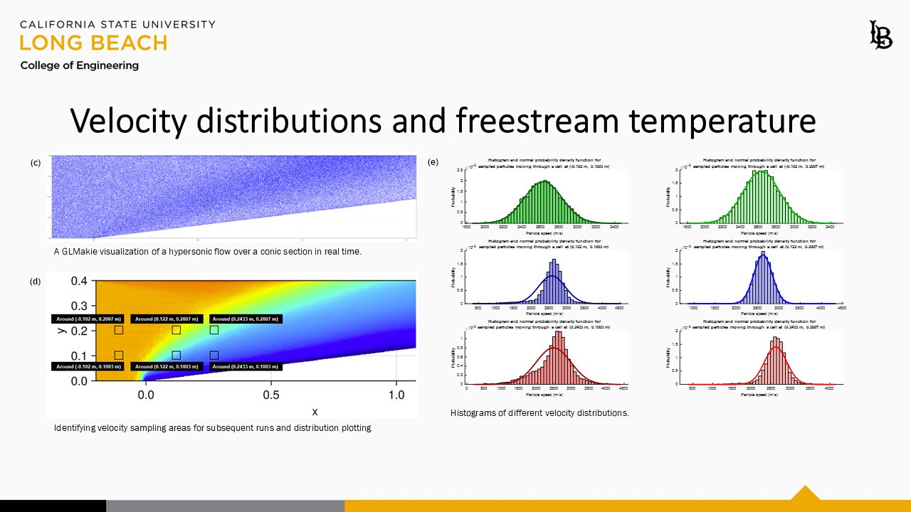

Michael, MS student in Aerospace Engineering, has completed his thesis titled "An investigation of the DSMC method's computing efficiency and velocity distributions in rarefied gas flow simulations".

