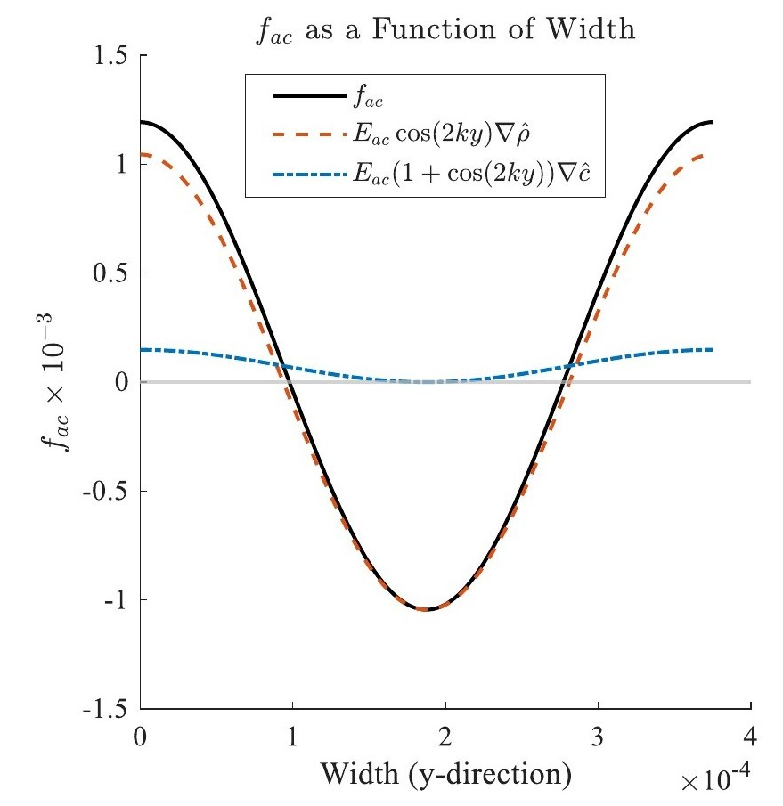

Elizabeth Alvarez has completed the Master of Science in Mechanical Engineering at CSULB with the thesis "Computational analysis of acoustic body force in inhomogeneous fluids," chaired by Prof. Ehsan Madadi with Prof. Navdeep Dhillon and Prof. Cody Karcher on the committee.

The thesis examines how the time-averaged acoustic body force acting on a fluid with spatially varying density and sound speed depends on the acoustic wavelength, the acoustic energy density and the property gradients in a rectangular microchannel, using aqueous iodixanol solutions as the working fluid. The force grows with the acoustic energy density and with the size of the property gradients, and for the selected conditions the density-gradient term dominates the sound-speed-gradient term. The work also reproduces linear and nonlinear acoustic propagation cases in OpenFOAM, laying the groundwork for coupled simulations of acoustically driven mixing. Congratulations, Elizabeth!

