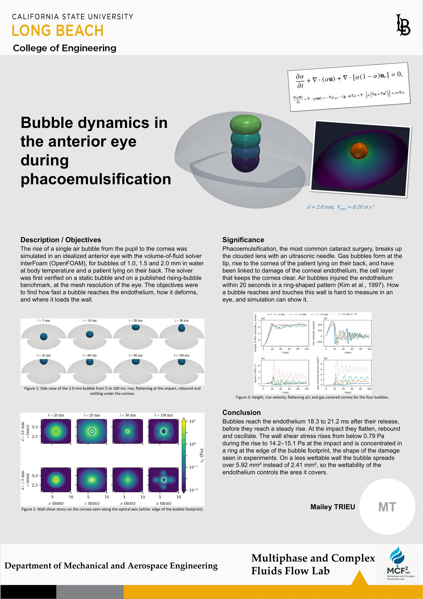

Mailey Trieu, an Honors student in Aerospace Engineering, has completed the B.S. degree with the honors thesis "Bubble dynamics in the anterior eye during phacoemulsification."

During cataract surgery, gas bubbles form at the tip of the ultrasonic needle and rise toward the cornea, where they have been linked to damage of the corneal endothelium. Mailey simulated the rise of single air bubbles of 1.0 to 2.0 mm in an idealized anterior eye with the volume-of-fluid solver interFoam in OpenFOAM. The bubbles reach the endothelium within about 20 ms, flatten and rebound at the impact, and load the wall most strongly in a ring at the edge of the bubble footprint, the same shape as the damage seen in experiments. Congratulations, Mailey!

