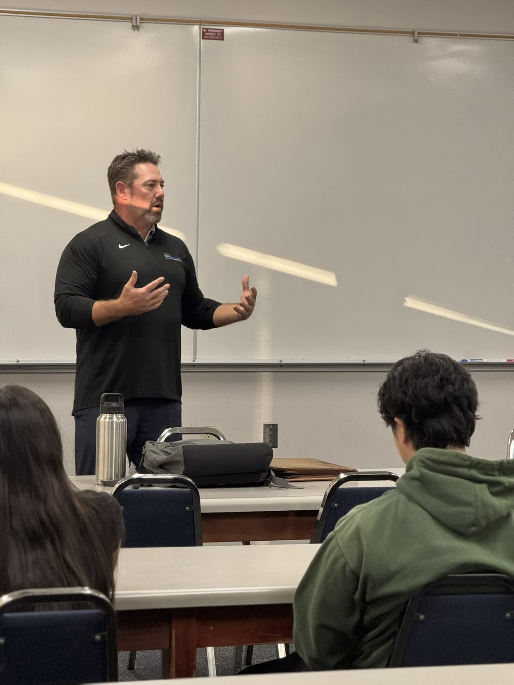

We hosted Russ Havens, Sales Engineer and Operations Director at Air Treatment Corporation, for an insightful lecture at California State University, Long Beach. Russ provided a comprehensive overview of HVAC system design and the industry's shift toward electrification. The event offered valuable insights into the project lifecycle, from concept to construction.

