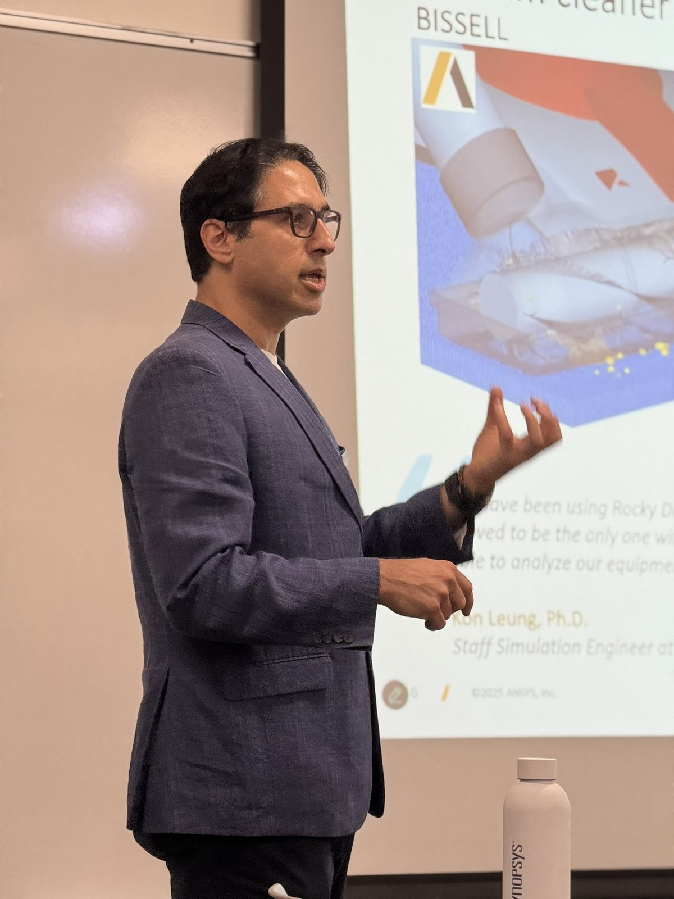
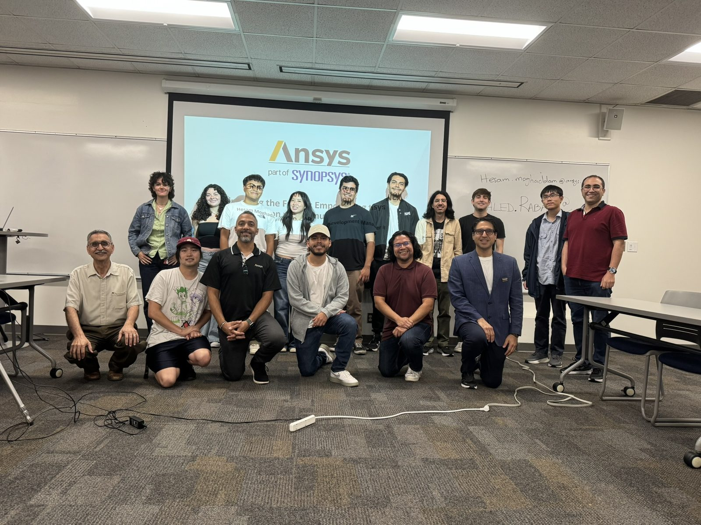

We hosted Dr. Hesam Moghaddam, Academic Development Manager at Ansys, for an insightful lecture at California State University, Long Beach. Hesam's workshop entitled "Empowering the next generation with simulation in Ansys" provided a comprehensive overview of Ansys tools and available resources for students.

